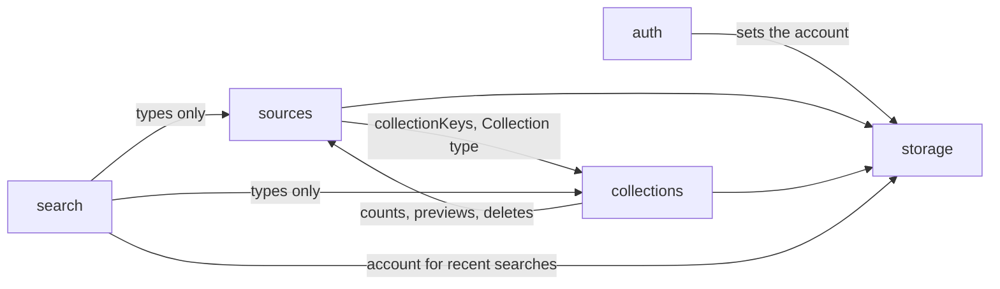

# Web App Architecture

How the domains in `src/features/` fit together. For the behavior of each one, read its `<feature>.spec.md`.

## Layers

Every domain uses the same four layers. Each layer only calls the layer below it.

```text
routes/ + components/        UI: pages, dialogs, cards
        │  calls hooks
features/<x>/…-hooks.ts      React Query: cache keys, mutations, toasts
        │  calls actions
features/<x>/…-actions.ts    Domain logic: validate (zod), read and write records
        │
features/storage/            IndexedDB (records)  ·  OPFS (media files, in sources/source-media.ts)
```

- The UI never touches IndexedDB or OPFS directly.
- Actions don't know about React. They are plain async functions and are tested with `fake-indexeddb`.
- Hooks own cache invalidation. After a write, they refresh every query that the change can affect.

## Domain map



| Domain        | Depends on                          | Why                                                                                                                                        |
| ------------- | ----------------------------------- | ------------------------------------------------------------------------------------------------------------------------------------------ |
| `auth`        | `storage`                           | Sets the account, which picks the database and the OPFS folder                                                                             |
| `storage`     | none                                | The base layer                                                                                                                             |
| `sources`     | `storage`, `collections`            | Stores records and files; uses `collectionKeys` to refresh counts and the `Collection` type for nesting                                    |
| `collections` | `storage`, `sources`                | Counts, previews and deletes go through `source-actions` (`countSourcesByCollection`, `collectBranchIds`, `softDeleteSourcesInCollection`) |
| `search`      | `collections`, `sources`, `storage` | Types only for the data; the account keys the recent-search list                                                                           |

**Known coupling:** `collections` and `sources` import each other, in both actions and hooks. It works because nesting rules (`collectBranchIds`) live in `sources`. If this grows, move the shared nesting helpers into `collections` or a small shared module.

## Outside the app

| Call                                   | Where                              | Why                                                                                 |
| -------------------------------------- | ---------------------------------- | ----------------------------------------------------------------------------------- |
| `GET /api/auth/get-session`            | `auth/auth-session.ts` (server fn) | Session check for every `(app)` page                                                |
| `better-auth` client                   | `auth/auth-client.ts`              | Sign-in, sign-up, reset, sign-out                                                   |
| `POST /api/v1/sites/preview`, `/image` | `sources/source-media.ts`          | Site metadata, embed mode, OG image (the browser can't fetch these because of CORS) |

The API lives in `apps/api`. Everything else stays on the device.

## Key flows

### Add a source

```text
drop / paste / action dock
  → useSourceDropzone / usePasteSource            (sources hooks)
  → useCreateSources → createSources              each file saved on its own
      → writeMediaFile (OPFS) → put record (IDB)
  → onSuccess: compressSource, queued one at a time
      → runCompression: skip if the storageKey changed or the record is gone
  → invalidate sources + collections queries      counts and previews update
```

A pasted URL goes `createWebsiteSource` → `fetchSitePreview` (API) → save the OG image or the X video.

### Replace a source's file

```text
toolbar / viewer / panel thumbnail
  → useReplaceSourceDropzone   one shared busy state (REPLACE_MUTATION_KEY)
  → replaceSourceFile
      → write the new file under a new key
      → in one transaction: decide the kind from fresh data, save the record
      → delete the old file
  → compressSource (the same queue as above)
```

### Delete a collection

```text
collection menu → confirm → useDeleteCollection → deleteCollection
  → one transaction over collections + sources:
      for the collection and every folder below it:
        softDeleteSourcesInCollection   trash the sources only here, detach the rest
        delete the collection
  → navigate to /library, refresh collections + sources + trash
```

### Account switch

```text
every (app) page: beforeLoad → loadPageSession
  → server: get-session
  → client: if the account changed → full reload (stops cross-account writes)
            else setStorageAccount(user.id)
  → openDatabase() and getMediaDirectory() now use that account's database and folder
sign-out → clear the query cache → full reload to /sign-in
```
