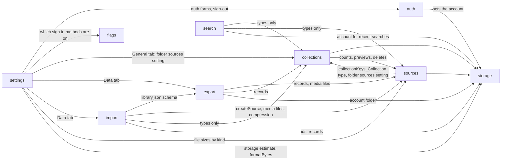

# Web App Architecture

How the domains in `src/features/` fit together. For the behavior of each one, read its `<feature>.spec.md`.

## Layers

Every domain uses the same four layers. Each layer only calls the layer below it.

```text
routes/ + components/        UI: pages, dialogs, cards
        │  calls hooks
features/<x>/…-hooks.ts      React Query: cache keys, mutations, toasts
        │  calls actions
features/<x>/…-actions.ts    Domain logic: validate (zod), read and write records
        │
features/storage/            IndexedDB (records)  ·  OPFS (account folder in storage-directory.ts, media in sources/source-media.ts)
```

- The UI never touches IndexedDB or OPFS directly.
- Actions don't know about React. They are plain async functions and are tested with `fake-indexeddb`.
- Hooks own cache invalidation. After a write, they refresh every query that the change can affect.

## Domain map



| Domain        | Depends on                                                               | Why                                                                                                                                                                                                                                                                                                                                                                                            |
| ------------- | ------------------------------------------------------------------------ | ---------------------------------------------------------------------------------------------------------------------------------------------------------------------------------------------------------------------------------------------------------------------------------------------------------------------------------------------------------------------------------------------- |
| `auth`        | `storage`                                                                | Sets the account, which picks the database and the OPFS folder                                                                                                                                                                                                                                                                                                                                 |
| `flags`       | none                                                                     | Reads feature flags from env; any domain may read them, and they read no domain                                                                                                                                                                                                                                                                                                                |
| `storage`     | none                                                                     | The base layer                                                                                                                                                                                                                                                                                                                                                                                 |
| `settings`    | `auth`, `collections`, `export`, `import`, `flags`, `sources`, `storage` | The panel hosts Google sign-in (and the paused email forms) and sign-out; it owns the theme choice (browser-wide, not per account, so it needs no other domain); the General tab shows the folder sources switch from `collections`; the Data tab shows storage used (file sizes from `sources`, the browser estimate from `storage`) and starts an export or an import; it owns no other data |
| `sources`     | `storage`, `collections`                                                 | Stores records and files; uses `collectionKeys` to refresh counts, the `Collection` type for nesting, and the folder sources setting to pick a collection's sources                                                                                                                                                                                                                            |
| `collections` | `storage`, `sources`                                                     | Counts, previews and deletes go through `source-actions` (`countSourcesByCollection`, `collectBranchIds`, `softDeleteSourcesInCollection`)                                                                                                                                                                                                                                                     |
| `search`      | `collections`, `sources`, `storage`                                      | Types only for the data; the account keys the recent-search list                                                                                                                                                                                                                                                                                                                               |
| `export`      | `collections`, `sources`, `storage`                                      | Reads every record and media file; builds the zip in the account's OPFS folder when there is no save picker                                                                                                                                                                                                                                                                                    |
| `import`      | `export`, `sources`, `collections`, `storage`                            | Reads `library.json` with export's schema; saves files through `sources`; writes records with their own ids                                                                                                                                                                                                                                                                                    |

**Known coupling:** `collections` and `sources` import each other, in both actions and hooks. It works because nesting rules (`collectBranchIds`) live in `sources`. If this grows, move the shared nesting helpers into `collections` or a small shared module.

## Outside the app

| Call                                   | Where                              | Why                                                                                 |
| -------------------------------------- | ---------------------------------- | ----------------------------------------------------------------------------------- |
| `GET /api/auth/get-session`            | `auth/auth-session.ts` (server fn) | Session check for every `(app)` page                                                |
| `better-auth` client                   | `auth/auth-client.ts`              | Google sign-in, sign-out (and email forms when turned on)                           |
| `POST /api/v1/sites/preview`, `/image` | `sources/source-media.ts`          | Site metadata, embed mode, OG image (the browser can't fetch these because of CORS) |

The API lives in `apps/api`. Everything else stays on the device.

## Key flows

### Action dock scrolling

`ActionDock` uses `useHideOnScroll` to hide after 200px of downward scrolling and return on upward scrolling. CSS limits scroll hiding to `prefers-reduced-motion: no-preference`, so the dock stays visible during scrolling with reduced motion enabled, including before hydration and when the preference changes. Focus inside the dock also keeps it visible.

### Add a source

```text
drop / paste / action dock
  → useSourceDropzone / usePasteSource            (sources hooks)
  → useCreateSources → createSources              each file saved on its own
      → writeMediaFile (OPFS) → put record (IDB)
  → onSuccess: compressSource, queued one at a time
      → runCompression: skip if the storageKey changed or the record is gone
  → invalidate sources + collections queries      counts and previews update
```

A pasted URL goes `createWebsiteSource` → `fetchSitePreview` (API) → save the OG image or the X video.

### Replace a source's file

```text
toolbar / viewer / panel thumbnail
  → useReplaceSourceDropzone   one shared busy state (REPLACE_MUTATION_KEY)
  → replaceSourceFile
      → write the new file under a new key
      → in one transaction: decide the kind from fresh data, save the record
      → delete the old file
  → compressSource (the same queue as above)
```

### Delete a collection

```text
collection page "…" menu  or  card context menu
  → confirm dialog → useDeleteCollection → deleteCollection
  → one transaction over collections + sources:
      for the collection and every folder below it:
        softDeleteSourcesInCollection   trash the sources only here, detach the rest
        delete the collection
  → refresh collections + sources + trash
  → from the collection page: navigate to /library. From a card: stay.
```

### Edit a collection from its card

```text
right-click / long-press a CollectionCard
  → CollectionContextMenu (MorphContextMenu from @repo/ui)
  → Rename / Change color / Delete → its dialog
  → useUpdateCollection → updateCollection (zod-checked)   or   the delete flow above
  → update the list and detail caches in place
```

### Account switch

```text
every (app) page: beforeLoad → loadPageSession
  → server: get-session
  → client: if the account changed → full reload (stops cross-account writes)
            else setStorageAccount(user.id)
  → openDatabase() and getMediaDirectory() now use that account's database and folder
sign-out → clear the query cache → full reload to /library (the guest library)
```

### Export the library

```text
Settings → Data → Export
  → useExportLibrary → openExportTarget          picker first: browsers allow it only right after a click
      Chrome/Edge: showSaveFilePicker → the user's file
      others:      remove zips over an hour old → new random-named zip in the account's exports/
  → exportLibrary
      → waitForCompressions                        compression rewrites files in place
      → fetchAllCollections + fetchAllSources     one snapshot, trash left out
      → buildExportLayout                          pure: folders, safe unique names, library.json
      → makeZip(readZipEntries).pipeTo(file)       one file at a time; a missing file is skipped and listed
      → finish: nothing, or download the OPFS file
  → toast: "Exported N sources." or the error
```

### Import a folder

```text
Settings → Data → Import a folder → <input webkitdirectory> → File[]
  → useImportLibrary → importLibrary
      → readManifest: library.json at the top, checked by exportManifestSchema (broken → plain folder)
      → readExistingIds: every collection and source key, trash included
      → buildImportPlan                     pure
          export folder: keep ids, skip ids already here, any copy of a file will do
          plain folder:  the picked folder and each subfolder → a new collection
      → saveCollections                      one transaction
      → each item, one at a time:
          export folder: writeMediaFile under a new key → add the record (never put)
          plain folder:  createSource
        one failure is counted, a full disk stops it
  → plain-folder sources go to the compression queue
  → refresh sources + collections, toast: "Imported N sources and M collections."
```

### Settings panel and email links

```text
⚙ button → ?settings=general → (app)/route.tsx renders SettingsDialog
  → useSettingsSearch parses settings, auth, token, verified, error (zod, bad values dropped)
  → General: the folder sources switch (useShowFolderSources from collections)
  → General: Light / Dark / System radios (useSettingsTheme)
  → Account, guest: SettingsAuthForm   signed in: name, email, Sign out
     email paused (default): only "Continue with Google"
     email on: Google button, then the email form (mode from ?auth)
Continue with Google → useGoogleSignIn → signInWithGoogle → POST /api/auth/sign-in/social
  → full-page redirect to Google → /api/auth/callback/google (Better Auth sets the cookie)
  → back to the same page; a fresh load picks the account storage
  → on error: same page + settings=account&error=code; fixed copy, raw text never shown
verify-email link → /library?settings=account&verified=true
reset link        → /library?settings=account&auth=reset-password&token=…
sign-in OK → full reload of the current page without the settings params
```

### Theme

```text
first load → SETTINGS_THEME_SCRIPT in <head> reads localStorage mado:theme
  + prefers-color-scheme → toggles html.dark before the body paints
hydrate → SettingsThemeSync (__root) → useSettingsTheme → createSettingsThemeStore
  → listens to device changes (System only) and storage events (other tabs)
Appearance radio → setPreference → html.dark at once → try save to localStorage
html.dark → .dark tokens in @repo/ui + color-scheme: dark
```

Dark mode accents and focus rings use the light mode background color (`oklch(0.96 0 0)`), with dark text on accent fills.
